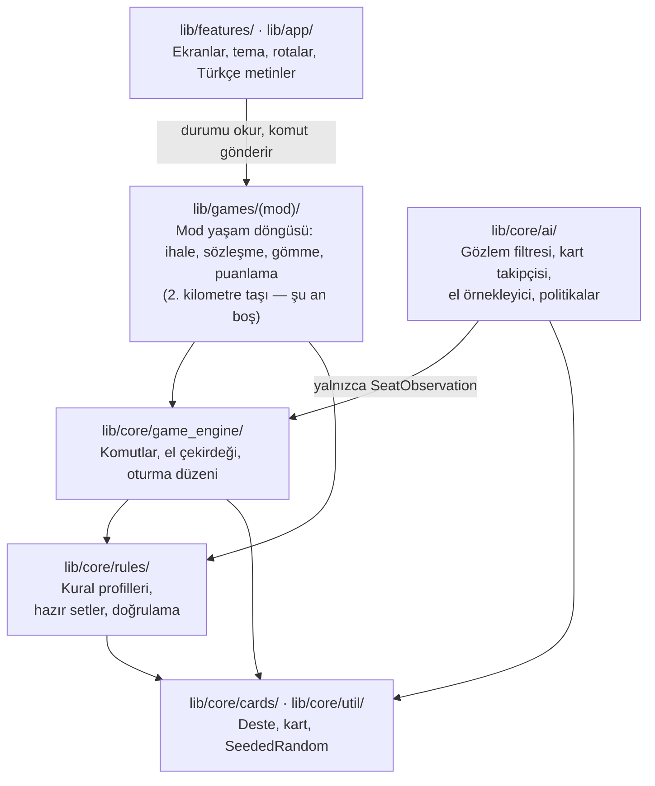

# Batak & King

Android ve iOS için **tamamen çevrimdışı** Türk kağıt oyunları.
Flutter, Dart, Riverpod. Yalnızca dikey (portre), ücretsiz, reklamsız,
hesapsız, ağ bağlantısı olmadan.

Planlanan beş mod: **Herkes Tek İhaleli Batak**, **Eşli İhaleli Batak**,
**Koz Maça**, **Üçlü Gömmeli Batak**, **King**.

---

## Durum: 1. kilometre taşı — yalnızca temel

> **Henüz hiçbir oyun modu oynanabilir değil.** Bu depo; alan modelini (domain),
> yapay zekanın bilgi mimarisini, Türkçe arayüz kabuğunu ve test/benchmark
> altyapısını içerir. `GameMode.isPlayable` her mod için `false` ve uygulama
> bunu ekranda açıkça belirtiyor.

| Alan | Durum |
|---|---|
| Kart modeli, tohumlu (seeded) dağıtım | ✅ Yazıldı, test edildi |
| Ortak el (trick) çekirdeği: kurallılık, kazanan, motor | ✅ Yazıldı, test edildi |
| Beş modun kural profilleri + doğrulama | ✅ Yazıldı, test edildi |
| YZ hile yapamama sınırı, kart takipçisi, el örnekleyici | ✅ Yazıldı, test edildi |
| Kurallı-rastgele temel çizgi politikası | ✅ Yazıldı, test edildi |
| Başsız (headless) simülatör ve benchmark CLI | ✅ Yazıldı, test edildi |
| Türkçe arayüz kabuğu (7 ekran) | ✅ Yazıldı |
| Mod yaşam döngüleri (ihale, sözleşme, gömme, puanlama) | ❌ **Başlanmadı** |
| Temel çizginin üstünde YZ | ❌ **Başlanmadı** |
| Diske kayıt, ses, animasyon | ❌ **Başlanmadı** |

Sıradaki işler için `docs/ROADMAP.md`, kararların gerekçeleri için
`docs/DECISIONS.md`, mimari için `docs/ARCHITECTURE.md`.

---

## Mimari — kuşbakışı



**Tek kural: bağımlılıklar yalnızca aşağı doğru akar.** `lib/core/` hiçbir
zaman Flutter'ı import etmez — ne widget, ne `dart:ui`, ne `dart:io`, ne de
saat. Böylece alan modeli ekransız, cihazsız ve saatsiz test edilebilir.

Ayrıntılı diyagramlar (komut akışı, YZ sınırı, el çekirdeği) için
`docs/ARCHITECTURE.md`.

---

## Kurulum

Bu kod **Flutter 3.47.9 / Dart 3.13.7** ile doğrulandı.

```bash
# Yerel platform klasörleri depoda tutulmuyor, üretilmesi gerekiyor:
flutter create . --platforms=android,ios --project-name batak_king

flutter pub get
# Uygulama ikonu da bu klasörlere üretiliyor, her flutter create'ten sonra:
dart run flutter_launcher_icons
dart format .
flutter analyze
flutter test
flutter run
```

### Doğrulanmış durum (Windows, 2026-10-31)

| Komut | Sonuç |
|---|---|
| `dart format .` | 80 dosya, 0 değişiklik — fark bırakmıyor |
| `flutter analyze` | `No issues found!` |
| `flutter test` | **138 testin tamamı geçti** |
| `dart run tool/benchmarks/run_baseline.dart --hands 2000` | 104.000 karar, **0 kural dışı hamle** |
| `flutter build apk --debug` | `app-debug.apk` üretildi |

Araç zinciri ve bu doğrulamanın ortaya çıkardığı layout hataları için
`docs/DECISIONS.md` D-1 ve D-13.

---

## Benchmark

```bash
dart run tool/benchmarks/run_baseline.dart --hands 2000 --players 4
dart run tool/benchmarks/run_baseline.dart --hands 2000 --rules kozmaca
dart run tool/benchmarks/run_baseline.dart --hands 2000 --rules notrump
```

Bu ölçüm **doğruluk** (sıfır kural dışı komut, her hamlede değişmezlerin
tutması) ve **verim** ölçer. **Güç ölçümü değildir:** şu an yazılmış tek ajan
kurallı-rastgele temel çizgidir. Bkz. `docs/AI_BENCHMARKS.md`.

---

## Dokümanlar

| Dosya | İçerik |
|---|---|
| `CLAUDE.md` | Kalıcı proje talimatları ve mimari kurallar |
| `docs/ARCHITECTURE.md` | Katmanlar, determinizm, komut modeli, YZ sınırı (diyagramlı) |
| `docs/ROADMAP.md` | Kilometre taşları, görev listesi, nerede kaldığımız |
| `docs/MAC_KURULUM.md` | Mac'te kurulum ve ilk görsel test adımları |
| `docs/RULE_PROFILES.md` | Kural varyantları, hazır setler ve açık kural soruları |
| `docs/AI_STRATEGY.md` | Hile yapamama garantisi, çıkarım, zorluk tasarımı |
| `docs/AI_BENCHMARKS.md` | Ölçüm protokolü ve "kanıtsız iddia yok" kuralı |
| `docs/DECISIONS.md` | Karar günlüğü (D-1 … D-15) |

---

## İlkeler

1. **Çalışma anında çevrimdışı.** Asla ağ yok.
2. **YZ gizli bilgiyi asla görmez.** Tek geçit `SeatObservation.fromState`.
3. **Uydurma kural yok.** Varyantlar belgelenir ve yapılandırılabilir.
4. **Sahte işlevsellik yok.** Tamamlanmamış özellik üründe etiketlenir.
5. **Benchmark kanıtı olmadan güç iddiası yok.**
