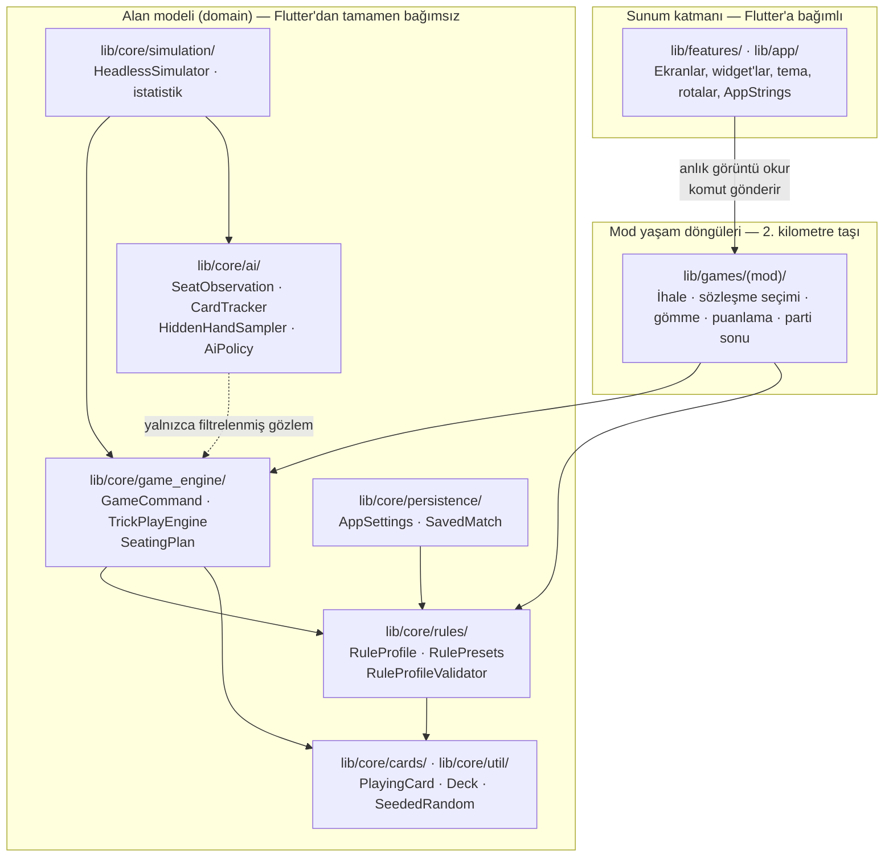
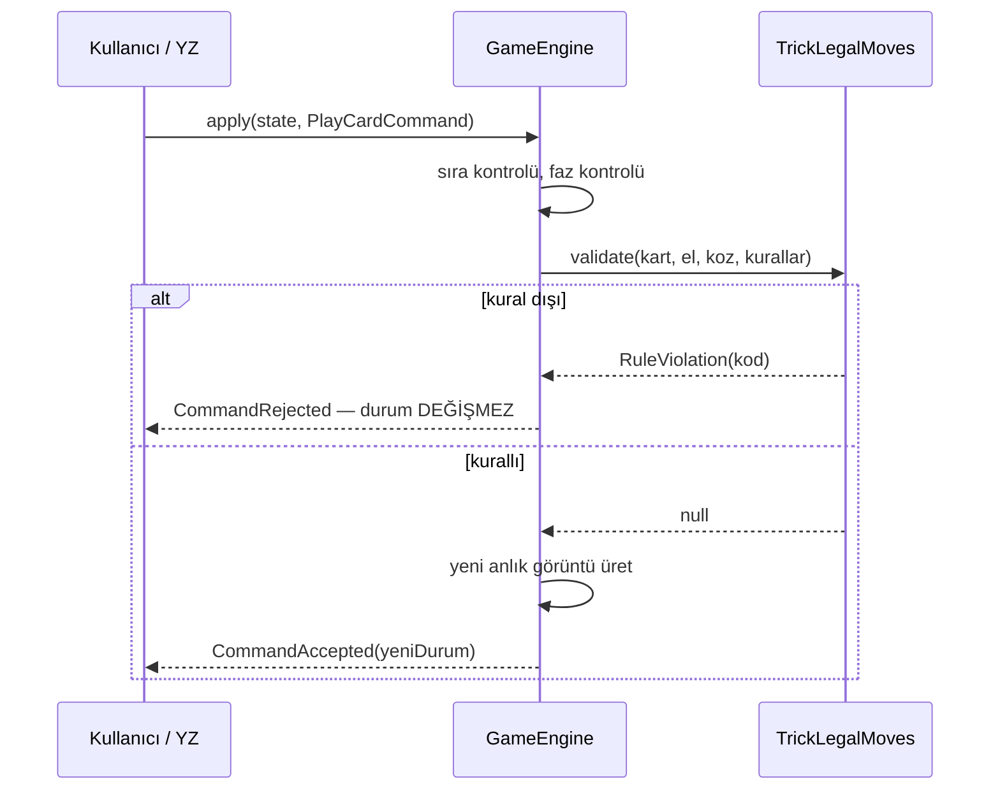
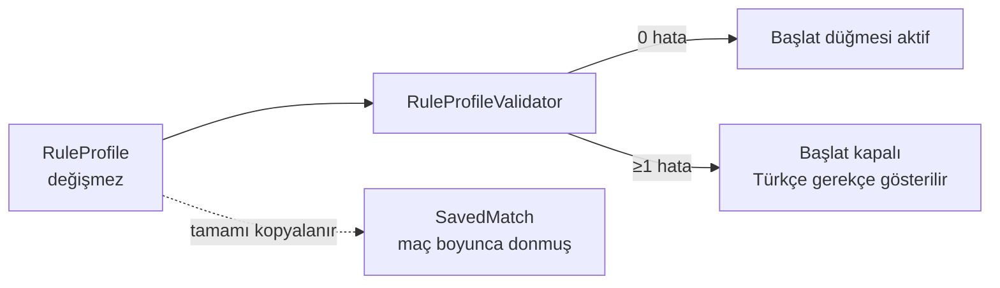
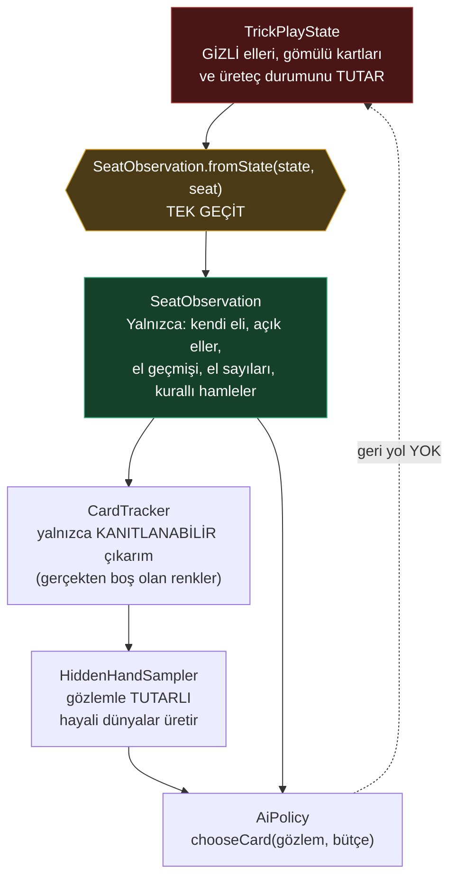

# Mimari

Bu belge kodun **neden** böyle bölündüğünü anlatır. Dosyaların nerede
durduğunu `CLAUDE.md` içindeki tablo, hangi işin sırada olduğunu
`ROADMAP.md` söyler.

---

## 1. Katmanlar



**Bağımlılıklar yalnızca aşağı akar.** `lib/core/` içinde şunların hiçbiri
bulunmaz: `package:flutter/*`, `dart:ui`, `dart:io`, cihaz API'si,
`DateTime.now()`, ortam rastgeleliği. Tek istisna `@immutable` için
`package:meta`.

### Alan modeli neden Flutter'dan bağımsız

Saflık uğruna değil, üç somut kazanç için:

1. **YZ ölçülebilir.** Binlerce el, düz bir Dart sürecinde milisaniyeler içinde
   koşar. Widget'a dokunan bir alan modeli bunu yapamazdı.
2. **Replay çalışır.** Bir anlık görüntü + komut listesi bir maçı birebir
   yeniden üretir. Hata raporunu eyleme dönüştüren ve kayıt dosyasını
   güvenilir kılan şey bu.
3. **Arama izole edilebilir.** Isolate'lar Flutter nesnesi paylaşamaz. Zaten
   düz veri olan bir alan modeli bu sınırı değişmeden geçer.

Bu kural lint ile zorlanamıyor — hiçbir birinci parti lint katman sınırı
ifade etmiyor. Dolayısıyla `CLAUDE.md`'deki import kuralı + inceleme ile
korunuyor.

---

## 2. Determinizm

Her koşuyu yeniden üretilebilir kılan üç kural:

- **Tüm rastgelelik `SeededRandom`'dan gelir** (xorshift64*, bu projenin
  kendi kodu). `dart:math` `Random` **yasak**: algoritması bir SDK uygulama
  detayı ve sürümler arasında değişebilir; bu da kaydedilmiş maçları ve
  benchmark temel çizgilerini sessizce geçersiz kılardı.
- **Motor kodu saat okumaz.** Zaman damgaları parametre olarak girer
  (`SavedMatch.savedAtEpochMillis`), asla alan modelinin içinden
  `DateTime.now()` ile değil.
- **Simülasyon partisinin `i`. eli `baseSeed + i` ile tohumlanır**, böylece
  bir benchmark'ı uzatmak daha önceki koşunun ellerini değiştirmez.

`SeededRandom.fork(salt)` bağımsız alt akışlar türetir; dağıtım, her YZ
koltuğunun örneklemesi ve benchmark altyapısı birbirine karışamaz. *Monte
Carlo örnek sayısını değiştirmek, dağıtılan kartları değiştirmemelidir.*

---

## 3. Komut modeli

Her niyet bir `GameCommand`. Uygulamak bir `CommandOutcome` döndürür:

```dart
switch (engine.apply(state, command)) {
  case CommandAccepted<S>(state: final next): state = next;
  case CommandRejected<S>(violation: final v): show(v.code);
}
```



Her motorun uyması gereken sözleşme:

| Özellik | Neden önemli |
|---|---|
| `apply`, `(state, command)` üzerinde saftır | Replay, isolate, test |
| `apply` girdisini asla değiştirmez | Anlık görüntü geçmişi geçerli kalır |
| Kural dışı girdi `CommandRejected` döner | Hatalı arayüz veya YZ oyunu bozamaz |
| Bozulan değişmez (invariant) **exception atar** | Programlama hatası sessiz kalmamalı |
| `legalCommands` ile `apply` birbiriyle tutarlıdır | Arayüz asla reddedilecek bir hamleyi vurgulamaz |

Son iki satır arasındaki ayrım kasıtlı: **kural dışı oyuncu girdisi** bir
reddetmedir (olağan, beklenen), **bozulmuş bir değişmez** ise bir programlama
hatasıdır ve gürültülü patlaması gerekir.

`RuleViolation` cümle değil **kod** taşır: alan modeli sunumdan arınmış kalır,
arayüz kodları Türkçeye çevirir, benchmark ihlalleri sayabilir. Sıfır olmayan
her sayı bir kusurdur — asla "kötü şans" değil.

---

## 4. Ortak el (trick) çekirdeği

Beş modun tamamı ihale, sözleşme ve puanlamada farklılaşır; **kart oyunu
kısmında aynıdır.** Bu yüzden kart oyunu bir kez yazıldı:

| Bileşen | Rolü |
|---|---|
| `Trick`, `CompletedTrick` | Bir elin herkese açık kaydı |
| `TrickResolver` | Kazanan: en yüksek koz, yoksa çıkılan rengin en yükseği |
| `TrickLegalMoves` | **Kart kurallılığının tek yetkilisi** |
| `TrickPlayState` | Kart oyunu fazının değişmez anlık görüntüsü |
| `TrickPlayEngine` | `PlayCardCommand`'ı doğrular ve uygular |

### Sırası gelen koltuk ile kararı veren koltuk

Açık Eşli Batak'ta bu ikisi farklı olabilir: kart eşin elinden çıkar, kararı
ihaleci verir. Motor bunları **ayrı** tutar ve birleştirmez:

| Kavram | Kim | Nerede |
|---|---|---|
| Sırası gelen, löveyi kazanacak koltuk | kartın sahibi | `TrickPlayState.turnSeat` |
| Kartı seçen koltuk | açık el için ihaleci | `controllerOf` |
| Seçenin okumaya hakkı olan eller | kendisi + açık olanlar | `visibleHandsFor` |

Kartlar eller arasında **taşınmaz**. `PlayCardCommand` kartın sahibinin
koltuğunu taşır, kurallılık o elin kartlarına göre denetlenir; bu yüzden
`TrickPlayEngine` bu mod için hiç değişmedi. Ayrıntı için `docs/DECISIONS.md`
D-30.

`TrickLegalMoves` kararını `TrickRules`'tan okur — bölgesel farklılık tam
olarak burada yaşar:

- renk vermek zorunluluğu,
- renk yoksa **koz kesme zorunluluğu**,
- mümkünse **üste koz atma** zorunluluğu,
- koz çıkma kısıtı (koz kırılmadan koz çıkılamaz),
- çıkılan rengi geçme zorunluluğu.

Hiçbir masanın âdeti koda gömülü değil. **Tek yetkili** olması kritik: motor,
arayüzdeki vurgulama ve her YZ politikası aynı fonksiyonu çağırır, bu yüzden
birbirleriyle çelişemezler.

Her mod bu çekirdeği `lib/games/<mod>/` altındaki kendi yaşam döngüsüyle
saracak. O dizinler 1. kilometre taşında **kasıtlı olarak boş**; bkz.
`lib/games/README.md`.

---

## 5. Kural profilleri

Bir `RuleProfile`, bir maçın **tam ve değişmez** kural setidir: el kuralları,
ihale, puanlama, gömme, King sözleşmeleri, sabit koz, desteden çıkarılan
kartlar ve bir `schemaVersion`.

İki özellik belirleyici:

- **Doğrulanmıştır.** `RuleProfileValidator` tipli sorunlar döndürür ve arayüz,
  bir `error` kaldığı sürece başlat düğmesini kapalı tutar. "Yalnızca mantıken
  tutarlı kombinasyonları göster" gereksinimi işte böyle zorlanır — eski bir
  kayıt dosyasından yüklenen profil için de.
- **Maç başına donmuştur.** `SavedMatch` profili **kimliğiyle değil tamamıyla**
  saklar; böylece ayarları değiştirmek ya da yeni varsayılanlar yayınlamak,
  sürmekte olan bir elin puanlamasını değiştiremez.

Türetilen değerler **hesaplanır, beyan edilmez** — böylece kayamazlar:

```
cardsSetAside     = gömme açıksa cardsToBury, değilse 0
playableCardCount = deckSize - cardsSetAside
tricksPerHand     = playableCardCount / playerCount
```

Bir gömme profilinin **eşit bölünmeyen bir desteyle başlaması beklenir**;
artan kart tam olarak gömmenin çözdüğü şeydir. Doğrulayıcı şunu kontrol eder:
`deckSize - playerCount * tricksPerHand == cardsSetAside`. (Bkz. D-10 — ilk
taslak burada tutarsızdı.)



Şu an gönderilen altı hazır setin **tamamı sıfır sorunla** doğrulanıyor:
`auction_batak_standard`, `partnership_batak_standard`,
`spades_batak_standard`, `buried_batak_standard`, `king_classic_20`,
`king_short_8`.

---

## 6. Yapay zeka sınırı — hile yapamama garantisi

Bu, projenin en kritik mimari sınırı.



**Garanti, politikanın imzasında yazılı:** `chooseCard(SeatObservation, budget)`.
Bir politikadan yetkili duruma geri giden hiçbir yol yok.

- `CardTracker` yalnızca **kanıtlanabilir** olguları türetir: hangi kartlar
  gitti, hangileri hâlâ görülmedi, hangi koltukların bir rengi **kanıtlı**
  olarak bitti — yani vermek zorunda olduğu bir renge vermediği için.
  Gerçek dağıtıma karşı test edilir: *kaydedilen her boşluk gerçek bir boşluk
  olmalıdır.*
- `HiddenHandSampler` gözlemle tutarlı gizli eller uydurur: doğru el
  büyüklükleri, oynanmış hiçbir kart tekrar değil, çıkarılmış hiçbir boşluk
  ihlal edilmemiş. Monte Carlo politikası gizli bilgi hakkında **kopya
  çekmeden** böyle akıl yürütür.
- **Test altyapısı** gerçek gizli durumu bir sonucu *puanlamak* için okuyabilir.
  Onu bir politikaya **asla geri besleyemez**.

Bu sınır `test/unit/ai_information_filter_test.dart` ile sınanıyor: her hamle
ve her koltuk için, gözlemin görebildiği kartların kümesi diğer koltukların
gerçek elleriyle **kesişmemek zorunda**.

---

## 7. Sunum

Oyun döngüsü motoru yok, düz Flutter widget'ları. Kartlar **prosedürel**
çiziliyor — gradyan, metin ve kenarlıkla — dolayısıyla uygulama hiçbir bitmap
varlıkla gelmiyor: indirilecek bir şey yok, her yoğunlukta net, ön ve arka
yüzler renk değiştirerek temalanabiliyor. `Flame` kasıtlı olarak bağımlılık
değil; bkz. D-2.

Riverpod **uygulama** durumunu, alan modeli **oyun** durumunu sahiplenir. Bir
ekran değişmez bir anlık görüntü okur ve komut gönderir; oyun durumunu asla
doğrudan değiştirmez.

Yalnızca dikey, insan oyuncu 0. koltukta (ekranın altında). `HandFan`
üst üste binme miktarını kullanılabilir genişlikten kendisi hesaplar, böylece
13 veya 17 kart dar bir telefona yatay kaydırma olmadan sığar. Metin
ölçeklemesi 1.35x'e kadar onurlandırılıp orada sabitlenir, böylece çok büyük
bir sistem yazı tipi masayı ekrandan taşırmaz.

**`AppPanel` `Material` üzerine kurulu, `DecoratedBox` üzerine değil** — bu bir
hatanın bedeliydi: `ListTile` ve `InkWell` zeminlerini ve dokunma dalgalarını
en yakın `Material` atasına boyar; araya giren renkli bir `DecoratedBox` onları
gizler. Bkz. D-13.

---

## 8. Simülasyon

`HeadlessSimulator`, koltuk başına bir `SeatDecider` ile yetkili motoru sürer,
**her hamleden sonra** değişmezleri doğrular ve koltuk başına sonuçları %95
güven aralığıyla, karar gecikmesini p50/p95 olarak raporlar.

Asenkron `AiPolicy` arayüzü yerine senkron bir callback alır: bu hacimlerde
kart başına bir future beklemek ölçümün kendisine baskın gelirdi.

Bugün yaptığı şey **gerçek**: ortak el çekirdeği üzerinde doğruluk ve verim.
Henüz **yapamadığı** şey bir maç kazanma oranı raporlamak — çünkü hiçbir modun
puanlama yaşam döngüsü yok. Bkz. `AI_BENCHMARKS.md`.

Son ölçüm (2026-10-31, 2000 el, 4 oyuncu, Batak kuralları):

```
Hands: 2000 · Decisions: 104.000 · Illegal: 0
Latency: p50 0us, p95 0us, max 134us
Throughput: 144.688 karar/s
Koltuk ortalamaları: 3.3085 / 3.2090 / 3.2660 / 3.2165  (toplam = 13.0 ✓)
```

Dört özdeş rastgele politikanın güven aralıklarının örtüşmesi ve ortalamaların
tam 13'e toplanması, ölçümün kendi içinde tutarlı olduğunun işareti.
